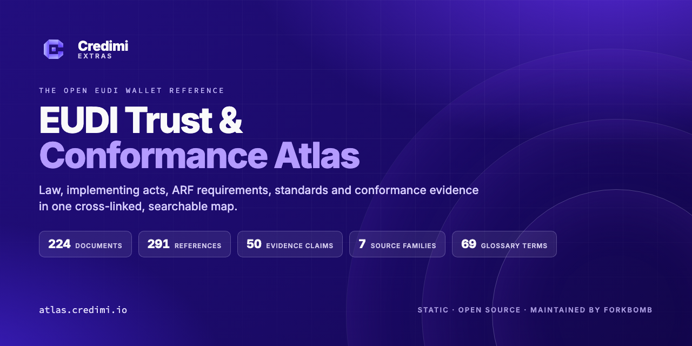

<div align="center">



# EUDI Trust & Conformance Atlas

**The open, always-current map of the EUDI Wallet rulebook.**

Law, implementing acts, the Architecture and Reference Framework, standards, protocols and conformance evidence — cross-linked, status-tracked and searchable in one static site.

[**Open the Atlas**](https://atlas.credimi.io) · [**Browse the reference**](https://atlas.credimi.io/reference) · [**Evidence claims**](https://atlas.credimi.io/tests) · [**Subscribe to the feed**](https://atlas.credimi.io/feed.xml)

[](https://github.com/ForkbombEu/eudi-conformance-atlas/stargazers)
[](https://atlas.credimi.io)
[](https://www.11ty.dev)
[](LICENSE)
[](https://github.com/ForkbombEu/eudi-conformance-atlas/commits/main)

</div>

---

## Why

The European Digital Identity Wallet (EUDI Wallet, eIDAS 2) is being built from a stack of documents that nobody has ever mapped end to end: regulations, implementing acts, the ARF, ETSI, OpenID4VC and IETF specifications, ISO/IEC 18013 mdoc, plus a live conformance evidence programme.
Tracking them by hand means reading PDFs, diffing EUR-Lex pages and hoping nothing slipped. The Atlas does the tracking for you:

- **Every document has an adoption status** — in force, adopted, published, final, draft, in development, proposal, superseded — with a status date, a note where relevant, and the versions pinned by the FCAF draft suite, the ARF essential-standards list and HAIP 1.0.
- **Every evidence claim links its provenance** — 291 official references grouped by source family (EU legal act, EUDI ARF, ETSI ESI, OpenID4VC, IETF, ISO, WE BUILD WP4), one row per reference with document ID, clause and purpose.
- **Everything is cross-linked** — documents to glossary topics, claims to tests, tests to documents, so "what does Article 4 require of the wallet?" is one click, not an afternoon.
- **Nothing is hidden in a database** — it is a static Eleventy site over plain YAML; no API, no lock-in, no account.

## What's inside

|         |                                                     |
| ------: | --------------------------------------------------- |
| **224** | documents mapped across the whole rulebook stack    |
| **291** | official references, grouped by 7 source families   |
|  **50** | evidence claims across 10 conformance profiles      |
|  **69** | glossary terms covering 221 documents               |
|   **0** | databases, build-time APIs or JavaScript frameworks |

Covers eIDAS Regulation (EU) 2024/1183, Implementing Regulations (EU) 2024/2977, 2024/2980, 2024/2981, 2024/2982, the EUDI ARF, ETSI TS 119 472, OpenID4VCI, OpenID4VP, SD-JWT VC, ISO/IEC 18013-5/-7 mdoc, the WE BUILD WP4 pilot work and the thirteen approved EWC EUDI Wallet RFCs.

## Highlights

- **Regulatory radar** — every document as a dot placed by stack layer and status, plus a momentum chart of status changes per half-year and a dated timeline.
- **Search-first reference** — filter all 224 documents by stack layer, status, type, ARF essential, or free text with shareable URL state (`?q=`, `?stack=`, `?role=`).
- **FCAF catalogue** — 676 wallet-solution test cases grouped by role and section, each with its normative references and a link to the upstream test definition.
- **Evidence registry** — each claim page shows actor under test, domain, status and its full reference list, normalized and counted per family.
- **Machine-readable data** — download the document map as YAML, subscribe to the Atom feed of rulebook updates, or read `llms.txt`.
- **SEO done properly** — canonical URLs, Open Graph and Twitter cards with a generated cover, JSON-LD (WebSite, Organization, WebPage, BreadcrumbList), sitemap and robots.txt on every page.

## HOW to run

Tasks are defined in `mise.toml`; `mise tasks` lists them.

```sh
mise install       # Node
mise run install   # npm ci
mise run test      # validate data, evidence and design assets
mise run fmt       # Prettier; files it must skip are listed in .prettierignore
mise run lint      # formatting check + DESIGN.md lint
mise run build     # writes _site/
mise run dev       # http://localhost:8080 with live reload
```

## Technical specs

The site is built with Eleventy and Nunjucks. Its canonical data selection is manifest-driven through `data/source-of-truth/current.json`; document and evidence data remain under `data/` and `content/`.

- `data/eudi-documents-map.yaml`: documents with `status`, quoted `status_date`, optional `status_note`, `pinned_versions` and `arf_essential_for`. The top-level `changelog` lists the documents added and updated in each review.
- `src/_data/docTypes.js`: the single list of document types, stack layers and statuses. It is used by templates, filters, the map tree and `scripts/validate-data.mjs`.
- `src/_data/site.js`: the site origin (default `https://atlas.credimi.io`, overridable via `SITE_URL`) used for canonical URLs, structured data, the sitemap and robots.txt.
- `src/sitemap.xml.njk`, `src/robots.txt.njk`, `src/llms.txt.njk`: SEO surfaces generated at build time. Every page carries canonical/Open Graph/Twitter meta, JSON-LD (WebSite, Organization, WebPage, BreadcrumbList) and a breadcrumb, and cross-links to related documents, glossary topics and reading routes.
- `src/feed.xml.njk`: an Atom feed at `/feed.xml` generated from `changelog`. Each review becomes one entry with its executive summary plus the linked new/updated documents; relative URLs and `tag:` URIs keep it host-agnostic.

## Quick GUI guide

### Home

Shows the rulebook stack, key figures, the regulatory radar (every document as a dot placed by stack layer and status), a diagram of who publishes the rules for which actors, the latest status changes and the Credimi platform offer. The visuals are SVG generated at build time from `src/_data/documents.js`; no client-side charting.

### Map

Browse the EUDI ecosystem map by task and use role filters where available. Leaves show each document's status.

### Reference and FCAF

Use **Reference** to filter all documents by stack layer, status, type, new or updated in this edition, and ARF essential, or by free text (`?q=`, `?stack=` and `?role=` preselect filters). Use **FCAF** to inspect the EUDI Wallet functional conformance catalogue — 676 wallet-solution test cases for the attestation-provider and relying-party roles, grouped by section with their normative references — and the Credimi evidence claims; each evidence claim page lists every official reference grouped by source family (EU legal act, EUDI ARF, ETSI ESI, OpenID4VC, IETF, ISO, WE BUILD WP4) with per-family counts and one row per reference (document ID, clause, purpose). `src/_data/evidence.js` normalizes those rows and fails the build on an unknown family, and `scripts/validate-source-of-truth-evidence.mjs` checks that no reference is dropped.

### Glossary

Read the rulebook by topic. Each of the 69 terms counts how many documents mention it, split by stack layer, and links to every related document. Terms and definitions live in `data/eudi-glossary.yaml`; the term-to-document counts are computed at build time by `src/_data/glossary.js` and checked by `scripts/validate-glossary.mjs`.

### Radar

Shows the radar, a momentum chart of status changes per half-year, what the latest review added and updated, drafts and proposals in the pipeline, latest versions against pinned versions, and a dated timeline.

### Data

Use **Data** for source-data access. The Atlas deliberately has no API documentation or OpenAPI endpoint.

## Contributing

Found a stale status, a missing document or a broken link? Open an issue or a pull request — the best fixes are edits to `data/eudi-documents-map.yaml` and the glossary. Every document, status change and evidence claim is validated at build time by `npm test`, so wrong data fails loudly.

The Atlas is part of the [Credimi](https://credimi.io) Extras family, maintained by [Forkbomb BV](https://github.com/ForkbombEu); promotional blocks for the Credimi platform are labelled "From the maintainers". It is Apache-2.0 licensed — see [LICENSE](LICENSE).

---

<div align="center">

If the Atlas saves you a PDF dive, a [star](https://github.com/ForkbombEu/eudi-conformance-atlas/stargazers) helps the next person find it.

</div>
